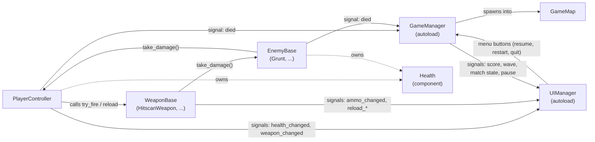

# Architecture

This is a short overview of how the game is put together. The repo ships a small **starter
loop** (first-person wave survival in a greybox arena) so there's something playable to build
on. Every piece of it is meant to be replaced or extended. The list at the bottom is written
so each item can become a GitHub issue people can claim.

## How the pieces fit



**Call down, signal up:**

- A parent may call methods on its children. The player calls `try_fire()` on its weapon.
- Children never reach up. They **emit signals** (`died`, `health_changed`, `ammo_changed`) and
  whoever cares connects to them.
- **UIManager only listens.** It displays state and never changes gameplay, except when menu
  buttons call into GameManager.
- **GameManager owns the match**: spawning the player and enemies, waves, score, win/lose,
  pause, and mouse capture.

**Scene flow:** `scenes/main.tscn` is the run scene. It instances `scenes/maps/arena.tscn` as
its `Map` child, and `scripts/main.gd` hands that map to `GameManager.start_match()`.
GameManager spawns the player at the map's `PlayerSpawn`, then runs waves of enemies from its
`EnemySpawns`. Restart reloads the scene and the same thing happens again.

**Shared setup** (`project.godot`):

- Autoloads: `GameManager`, `UIManager`
- Input actions: `move_forward/back/left/right`, `jump`, `crouch`, `sprint`, `fire`, `aim`,
  `reload`, `weapon_next`, `weapon_prev`, `pause` (see README for default keys)
- 3D physics layers: `1 world`, `2 player`, `3 enemies`, `4 projectiles`, `5 pickups`

## Contracts everyone shares

**Damage.** Anything that can be hurt has a child `Health` node (`scripts/core/health.gd`) and
a method:

```gdscript
func take_damage(amount: float, source: Node = null) -> void:
    health.take_damage(amount, source)
```

Weapons and enemies only ever call `take_damage()` on whatever they hit (checking
`has_method("take_damage")` first). `Health` emits `health_changed(current, maximum)` and
`died(source)`. A breakable crate, an explosive barrel, or a turret just needs the same two pieces.

**Groups.** The player is in the `player` group while alive (enemies find their target that way)
and enemies are in `enemies`.

**Collision layers.** Player: layer 2, collides with world + enemies. Enemies: layer 3, collide
with world + player + enemies. Player weapons hit world + enemies (`hit_mask` on WeaponBase).

## How to add things

**A new weapon:** make a scene in `scenes/weapons/` whose root uses `hitscan_weapon.gd` (or your
own script that `extends WeaponBase` and overrides `_shoot()`). Tune damage, fire rate, and ammo
in the Inspector. Instance it as another child of the player's `Head/Camera3D/WeaponHolder`.
Scroll wheel / Q / E already cycle between weapons.

**A new enemy:** make `scripts/enemies/<name>.gd` with `extends EnemyBase` and override
`_attack(target)`. Build the scene like `scenes/enemies/grunt.tscn` (CharacterBody3D on layer 3
with `Health`, `NavigationAgent3D`, and a `Body` mesh). Add it to `ENEMY_SCENES` in
`game_manager.gd` so waves can spawn it.

**A new map:** make a scene in `scenes/maps/` whose root uses `scripts/maps/game_map.gd` and
contains `PlayerSpawn` (Marker3D), `EnemySpawns` (Node3D with Marker3D children), and a
`NavigationRegion3D` wrapping the level geometry. Easiest is to duplicate `arena.tscn`. While
greyboxing with CSG, leave `bake_navmesh_on_ready` on so enemy pathing follows your edits.

## Systems

Each item is meant to be one GitHub issue (large ones split into a few). **Depends on** lists
what needs to exist first. ✅ means a starter version exists; it's still fair game to improve.

### Foundation

1. ✅ **Input map**: all actions defined in `project.godot`.
2. ✅ **Damage/health contract**: `Health` component + `take_damage()`, documented above.
3. ✅ **Greybox test map**: `scenes/maps/arena.tscn` (CSG walls, cover, a ramped platform, spawn
   points, navmesh baked at load).

### Player (`scenes/player/`, `scripts/player/`)

4. **Player movement**: ✅ walk, sprint, jump, gravity. ⬜ **Crouch** (the `crouch` action is
   already mapped). *Good first issue.*
5. ✅ **Mouse look & camera**: sensitivity is an export on PlayerController.
6. ✅ **Player health & death**: damage flash on the HUD, camera drops on death.
7. ✅ **Weapon holding & switching**: cycling works; there's only one weapon to cycle so far.
8. ⬜ **Aim down sights** using the `aim` action (zoom FOV, move weapon to center). *Depends on: 7*
9. ⬜ **Health pickups / ammo pickups** (physics layer 5 is reserved). *Depends on: 6, 10*

### Weapons (`scenes/weapons/`, `scripts/weapons/`)

10. ✅ **WeaponBase core**: fire rate, magazine, reserve, reload, auto-reload when empty.
11. ✅ **Hitscan weapon**: `HitscanWeapon` + `rifle.tscn`.
12. ⬜ **Second hitscan weapon** (pistol or shotgun with spread). *Good first issue.*
13. ⬜ **Projectile weapon** (grenade/rocket) extending WeaponBase, using physics layer 4.
14. **Weapon feedback**: ✅ muzzle flash light, recoil kick, impact puffs.
    ⬜ fire/reload sounds, impact decals, reload animation, camera shake.

### Enemies (`scenes/enemies/`, `scripts/enemies/`)

15. ✅ **EnemyBase core**: health, death, hit flash, `died` signal.
16. ✅ **Navigation & AI states**: idle → chase → attack with NavigationAgent3D.
17. ✅ **First enemy type**: `Grunt` (melee).
18. ⬜ **Ranged enemy** that uses a WeaponBase or throws projectiles. *Depends on: 13 or 11*
19. ⬜ **Smarter AI**: line-of-sight checks, flanking, avoidance between enemies
    (NavigationAgent3D has `avoidance_enabled`).

### Game flow (`scripts/core/`)

20. ✅ **Match flow**: start, win (survive `waves_to_win`), lose, restart.
21. ✅ **Waves**: each wave spawns `1 + 2 × wave` enemies, a bit faster each wave.
22. ⬜ **Wave design**: mix enemy types per wave, bosses, tuning. *Depends on: 18*
23. ⬜ **Map loading**: GameManager picks and swaps maps into `main.tscn`. *Depends on: a second map*
24. ⬜ **High score** saved to `user://`.

### UI (`scenes/ui/`, `scripts/ui/`)

25. ✅ **HUD**: health, ammo, reload, crosshair, score, wave, enemies left, wave banner.
26. ✅ **Pause menu**: resume, restart, quit.
27. ✅ **Game over / victory screen**.
28. ⬜ **Main menu**: play, settings, quit. *No dependencies*
29. ⬜ **Settings**: mouse sensitivity, volume, graphics. *Depends on: 28*

### Art & audio (`assets/`, always via Git LFS)

30. ⬜ **Weapon models** (one issue per weapon), replacing the box rifle
31. ⬜ **Enemy model & animations**, replacing the capsule
32. ⬜ **Environment kit**: modular walls, floors, props to replace the CSG greybox
33. ⬜ **Sound effects**: weapons, footsteps, hits, UI clicks
34. ⬜ **Music**: menu and in-game tracks
35. ⬜ **UI art & fonts**: crosshair, icons, HUD font

### Tooling

36. ✅ **CI check**: `.github/workflows/godot-check.yml` opens the project headless on every push and PR.
37. ⬜ **Issue & PR templates** in `.github/`.
