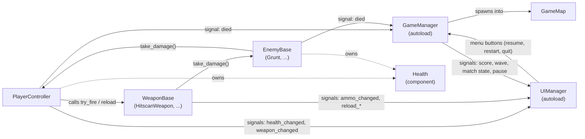

# Architecture

This is a short overview of how the game is put together. The repo ships a small **starter
loop** (first-person wave survival in a greybox arena) so there's something playable to build
on. Every piece of it is meant to be replaced or extended. Art is still primitives + procedural
materials and sound is synthesized (`scripts/core/sfx.gd`), so swapping in real assets is the
biggest open area. The list at the bottom is written
so each item can become a GitHub issue people can claim.

## How the pieces fit



**Call down, signal up:**

- A parent may call methods on its children. The player calls `try_fire()` on its weapon.
- Children never reach up. They **emit signals** (`died`, `health_changed`, `ammo_changed`) and
  whoever cares connects to them.
- **UIManager only listens.** It displays state and never changes gameplay, except when menu
  buttons call into GameManager.
- **GameManager owns the match**: spawning the player and enemies, waves, score, win/lose,
  pause, and mouse capture.

**Scene flow:** `scenes/main.tscn` is the run scene and starts empty. `GameManager.begin_run()`
either shows the main menu or instances the chosen map from `GameManager.MAPS` as `Main/Map` and
starts the match. `load_map()`, `restart()` and `return_to_menu()` all reload the run scene;
GameManager (an autoload) remembers which map is chosen.

**Two modes:** a map with a child `Mission` (a `MissionDirector`, e.g.
`scenes/missions/recon_extract.tscn`) runs as a mission; any other map runs arena waves. The
director runs its objective children in order (reach area, hold-to-interact, destroy targets,
hold area), finds its anchors by name under the map's `MissionPoints`, spawns unaware guards and
patrols, and relays progress through GameManager's `objective_*` and `mission_completed` signals,
which the HUD and results screen listen to. Stars and best times are saved in `user://records.cfg`.

**Big outdoor maps** add navmesh geometry from any node in group `"nav_source"` that implements
`add_nav_geometry(source)` (the forest terrain and tree trunks do), and can bake asynchronously
(`bake_async`).

**Shared setup** (`project.godot`):

- Autoloads: `GameManager`, `UIManager`
- Input actions: `move_forward/back/left/right`, `jump`, `crouch`, `sprint`, `fire`, `aim`,
  `reload`, `weapon_next`, `weapon_prev`, `pause` (see README for default keys)
- 3D physics layers: `1 world`, `2 player`, `3 enemies`, `4 projectiles`, `5 pickups`

## Contracts everyone shares

**Damage.** Anything that can be hurt has a child `Health` node (`scripts/core/health.gd`) and
a method:

```gdscript
func take_damage(amount: float, source: Node = null) -> bool:  # true if this hit killed
    return health.take_damage(amount, source)
```

Weapons and enemies only ever call `take_damage()` on whatever they hit (checking
`has_method("take_damage")` first). `Health` emits `health_changed(current, maximum)` and
`died(source)`, and can regenerate (`regen_delay`, `regen_per_second`).
**Headshots:** a CollisionShape3D with metadata `damage_multiplier` (enemy heads use 2.5)
scales damage; weapons emit `hit_landed(headshot, killed)` for the hit marker. A breakable crate, an explosive barrel, or a turret just needs the same two pieces.

**Groups.** The player is in the `player` group while alive (enemies find their target that way)
and enemies are in `enemies`.

**Collision layers.** Player: layer 2, collides with world + enemies. Enemies: layer 3, collide
with world + player + enemies. Player weapons hit world + enemies (`hit_mask` on WeaponBase).

## How to add things

**A new weapon:** make a scene in `scenes/weapons/` whose root uses `hitscan_weapon.gd` (or your
own script that `extends WeaponBase` and overrides `_shoot()`). Tune damage, fire rate, and ammo
in the Inspector. Instance it as another child of the player's `Head/Camera3D/WeaponHolder`.
Scroll wheel / Q / E already cycle between weapons.

**A new enemy:** make `scripts/enemies/<name>.gd` with `extends EnemyBase` and override
`_attack(target)` (and optionally `_wants_to_attack` / `_attack_update` for ranged behaviour,
see `soldier.gd`). Build the scene like `scenes/enemies/grunt.tscn` (CharacterBody3D on layer 3
with `Health`, `NavigationAgent3D`, body + `Head` hitboxes, and a `HumanoidRig`). Add it to
`_build_wave()` in `game_manager.gd` so waves can spawn it.

**A new mission:** add objective nodes (see `scripts/missions/`) under a MissionDirector and
place the anchors it needs under the map's `MissionPoints`.

**A new map:** make a scene in `scenes/maps/` whose root uses `scripts/maps/game_map.gd` and
contains `PlayerSpawn` (Marker3D), `EnemySpawns` (Node3D with Marker3D children), and a
`NavigationRegion3D` wrapping the level geometry. Easiest is to duplicate `arena.tscn`. While
greyboxing with CSG, leave `bake_navmesh_on_ready` on so enemy pathing follows your edits.

## Systems

Each item is meant to be one GitHub issue (large ones split into a few). **Depends on** lists
what needs to exist first. ✅ means a starter version exists; it's still fair game to improve.

### Foundation

1. ✅ **Input map**: all actions defined in `project.godot`.
2. ✅ **Damage/health contract**: `Health` component + `take_damage()`, documented above.
3. ✅ **Greybox test map**: `scenes/maps/arena.tscn` (CSG walls, cover, a ramped platform, spawn
   points, navmesh baked at load).

### Player (`scenes/player/`, `scripts/player/`)

4. ✅ **Player movement**: walk, sprint (lowers the gun), jump, crouch (fits behind barriers).
5. ✅ **Mouse look & camera**: recoil, damage flinch, landing dip, weapon sway/bob (`weapon_holder.gd`).
6. ✅ **Player health & death**: damage flash on the HUD, camera drops on death.
7. ✅ **Weapon holding & switching**: cycling works; there's only one weapon to cycle so far.
8. ✅ **Aim down sights**: FOV zoom to `aim_fov`, red dot aligned via the weapon's `aim_position`.
9. ⬜ **Health pickups / ammo pickups** (physics layer 5 is reserved). *Depends on: 6, 10*

### Weapons (`scenes/weapons/`, `scripts/weapons/`)

10. ✅ **WeaponBase core**: fire rate, spread model (hip/ADS/move/air/crouch + bloom), recoil, tactical (30+1) and empty reloads.
11. ✅ **Hitscan weapon**: `HitscanWeapon` + `rifle.tscn`.
12. ⬜ **Second hitscan weapon** (pistol or shotgun with spread). *Good first issue.*
13. ⬜ **Projectile weapon** (grenade/rocket) extending WeaponBase, using physics layer 4.
14. ✅ **Weapon feedback**: muzzle flash, tracers, impact particles, bullet-hole decals, reload animation, hit markers.
    ⬜ real recorded sounds (drop `assets/audio/<name>.ogg` to replace a synthesized one).

### Enemies (`scenes/enemies/`, `scripts/enemies/`)

15. ✅ **EnemyBase core**: health, stagger, line of sight, death animation, `died` signal.
16. ✅ **Navigation & AI states**: idle → chase → attack with NavigationAgent3D.
17. ✅ **First enemy type**: `Grunt` (melee rusher).
18. ✅ **Ranged enemy**: `Soldier` fires 3-round bursts with an `enemy_rifle.tscn` when it can see you.
19. ⬜ **Smarter AI**: line-of-sight checks, flanking, avoidance between enemies
    (NavigationAgent3D has `avoidance_enabled`).

### Game flow (`scripts/core/`)

20. ✅ **Match flow**: start, win (survive `waves_to_win`), lose, restart.
21. ✅ **Waves**: `1 + 2 × wave` enemies; from wave 2, `wave - 1` of them are Soldiers.
22. ⬜ **Wave design**: mix enemy types per wave, bosses, tuning. *Depends on: 18*
23. ✅ **Map loading**: main menu → `GameManager.load_map()`; add a map by listing it in `MAPS`.
24. ⬜ **High score** saved to `user://`.

### UI (`scenes/ui/`, `scripts/ui/`)

25. ✅ **HUD**: health, ammo, reload, crosshair, score, wave, enemies left, wave banner.
26. ✅ **Pause menu**: resume, restart, quit.
27. ✅ **Game over / victory screen**.
28. ✅ **Main menu**: both modes with best stars/time. ⬜ Settings screen still open.
29. ⬜ **Settings**: mouse sensitivity, volume, graphics. *Depends on: 28*

### Art & audio (`assets/`, always via Git LFS)

30. ⬜ **Weapon models** (one issue per weapon), replacing the box rifle
31. ⬜ **Enemy model & animations**, replacing the capsule
32. ⬜ **Environment kit**: modular walls, floors, props to replace the CSG greybox
33. ⬜ **Sound effects**: replace the synthesized placeholders with recorded CC0 audio
34. ⬜ **Music**: menu and in-game tracks
35. ⬜ **UI art & fonts**: crosshair, icons, HUD font

### Tooling

36. ✅ **CI check**: `.github/workflows/godot-check.yml` opens the project headless on every push and PR.
37. ⬜ **Issue & PR templates** in `.github/`.
